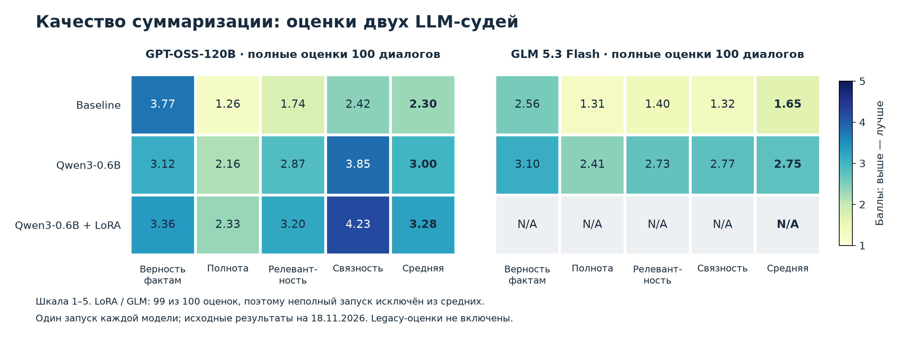
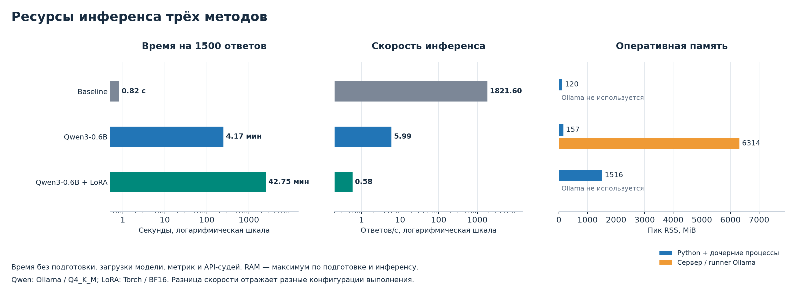
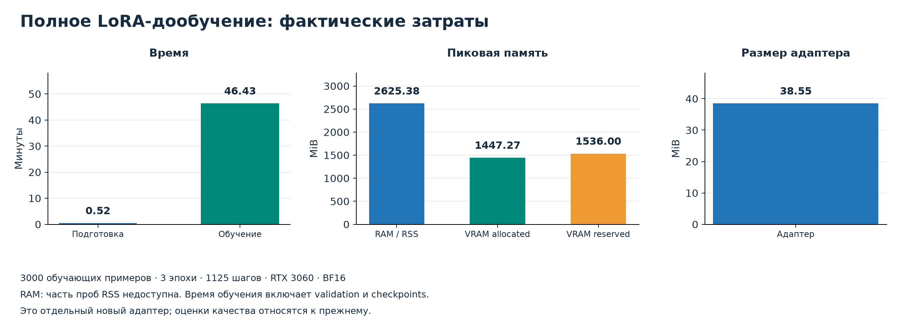

# Суммаризация диалогов: Baseline, Qwen3 и LoRA

Модульная версия логики `notebooks/main.ipynb`. Исходные CSV и вся папка `notebooks/` используются только для чтения. План и требования находятся в `spec.md`, `plan.md`, ход работ — в `tasks.md`.

# Архитектура решения 

- Baseline (конкатенация предложений)
- Qwen3-0.6B без post-training
- Qwen3-0.6B с LoRA адаптерами 

## Оценка 

- Автоматические метрики (BLEU, ROUGE)
- LLM-as-judge: GPT-OSS-120B и GLM 5.3 Flash, каждый оценивает одну и ту же подвыборку.

Ниже — историческая сводка v1 в `results/` на 12.11.2026, до выравнивания лимита LoRA до 64. Полный пересчёт v2 выполняется пользователем по командам ниже; новые результаты не подставлены вместо старых. BLEU и ROUGE рассчитаны по всем 1500 диалогам test: BLEU — в шкале 0–100, ROUGE — средний F1 в шкале 0–1.

| Модель | BLEU (corpus) | BLEU (средний sentence) | ROUGE-1 | ROUGE-2 | ROUGE-L | ROUGE-Lsum |
| --- | ---: | ---: | ---: | ---: | ---: | ---: |
| Baseline | 2.7274 | 3.5170 | 0.1505 | 0.0417 | 0.1298 | 0.1328 |
| Qwen3-0.6B | 4.6053 | 5.1572 | 0.2708 | 0.0702 | 0.2080 | 0.2333 |
| Qwen3-0.6B + LoRA | 18.9421 | 18.4906 | 0.4297 | 0.1751 | 0.3519 | 0.3816 |

Средние оценки LLM-as-judge (`openai/gpt-oss-120b`), шкала 1–5:

| Модель | Оценено диалогов | Faithfulness | Coverage | Relevance | Coherence | Overall |
| --- | ---: | ---: | ---: | ---: | ---: | ---: |
| Baseline | 99 | 3.6465 | 1.2626 | 1.6970 | 2.3939 | 2.2500 |
| Qwen3-0.6B | 100 | 3.1400 | 2.2300 | 2.9100 | 3.7500 | 3.0075 |
| Qwen3-0.6B + LoRA | 100 | 3.3700 | 2.2700 | 3.2300 | 4.3400 | 3.3025 |

Численные метрики взяты из `results/<модель>/summary.csv`, оценки судьи — из `judge.csv`. Судейские оценки исторические (`legacy_unverified`): перенесены из `notebooks/routerai_judge_results.csv`, где нет текста оценённого ответа, поэтому их соответствие текущим предсказаниям не подтверждено. Таблицы — статическая сводка; актуальное сравнение после новых запусков выводит `scripts/report.py`.

## Структура

```text
configs/                   YAML для baseline, qwen (Ollama), lora
scripts/train.py           дообучение Qwen3 с LoRA
scripts/evaluate.py        инференс test + BLEU/ROUGE + необязательный судья, без таблиц
scripts/report.py          сравнение моделей по готовым CSV
src/text_summary_block_7/  конфиги, данные, модели, обучение, метрики, артефакты, отчёты
tests/                     автоматические проверки
results/                   новые CSV и настройки запусков
models/                    новые адаптеры и checkpoints (не включаются в Git)
data/                      исходные train/test/validation (не изменяются)
notebooks/                 исходные исследования, предсказания и адаптер (не изменяются)
```

## Установка

Нужен Python 3.12 или 3.13 и Poetry. LoRA использует NVIDIA GPU, CUDA-сборку PyTorch и Unsloth. В проекте зафиксированы PyTorch 2.14.0+cu130, Transformers 5.17.0, Unsloth/Unsloth Zoo 2026.11.4, TRL 1.15.0 и Datasets 4.8.5. Для Torch/torchvision задан отдельный официальный CUDA-источник Poetry: обычная установка CPU-сборки не подменяет GPU-зависимость.

```powershell
poetry install
poetry run python -m nltk.downloader punkt punkt_tab
poetry run python -c "import torch; print(torch.__version__, torch.cuda.is_available())"
```

Для Windows нужен `triton-windows` (в зависимостях проекта); требования к драйверу и инструментам сборки приведены в [инструкции Unsloth](https://unsloth.ai/docs/get-started/install/windows-installation). Источник CUDA wheels — [PyTorch](https://pytorch.org/get-started/locally/). Короткие реальные проверки и ограничения локальной среды записываются в `verification.md`.

Для zero-shot запустите Ollama и загрузите модель:

```powershell
ollama pull qwen3:0.6b
```

Для обоих судей нужен один `ROUTERAI_API_KEY` в окружении либо локальном `.env` в корне. Ключ не записывается в YAML или результаты. API вызывается **только** с флагом `--llm-as-judge`; без него ключ не нужен. Модели: `openai/gpt-oss-120b` и `z-ai/glm-5.3-flash`, prompt и критерии общие, сохранены из notebook.

## Конфиги и аргументы командной строки

`baseline.yaml`, `qwen.yaml`, `lora.yaml` — самостоятельные конфиги. Их разделы: `seed`, `data`, `paths`, `model`, `generation`, `metrics`, `judge`, `resources`, `lora`, `training`. Последние два применяются только к обучению LoRA. Все настройки можно переопределить без редактирования YAML.

В v2 одиночный `judge.model` заменён на `judge.models.gpt_oss.model` и `judge.models.glm_flash.model`. Старый пользовательский YAML нужно обновить по поставляемым примерам; старые CSV продолжают читаться. Общие параметры запросов заданы в `judge`, индивидуальные переопределения — внутри записи судьи, например `--set judge.models.glm_flash.max_tokens=2048`. Поле `resources.sample_interval_seconds` задаёт интервал выборочного мониторинга, по умолчанию 0.2 с.

Приоритет: YAML → повторяемый `--set` → явно указанный именованный аргумент. Например:

```powershell
poetry run python scripts/train.py --config configs/lora.yaml --learning-rate 0.0002 --set lora.r=32
```

Здесь остальные параметры берутся из YAML, learning rate равен `0.0002`, ранг LoRA — `32`. Значения `--set` разбираются как YAML: числа, `true`/`false`, списки и строки. Неизвестные ключи и неверные типы отвергаются до загрузки модели. Относительные пути в YAML считаются от каталога конфига, пути из CLI — от текущего каталога.

## Дообучение

```powershell
poetry run python scripts/train.py --config configs/lora.yaml
```

По умолчанию используются `Qwen/Qwen3-0.6B`, 3000 train-примеров с seed 42, полный validation, 3 эпохи, LoRA r/alpha 16, learning rate `1e-4`. Обучаются только параметры адаптера, loss — только по completion. Train и validation не пересекаются по ID. Входы: `data/train.csv/train.csv`, `data/validation.csv`.

Адаптер и токенизатор сохраняются в `models/qwen3_summary_lora`, checkpoints — в его подкаталог; `training-run.yaml` содержит настройки и результат обучения. Существующий адаптер в выходном каталоге не перезаписывается: выберите новый `--output-dir`. В новых версиях TRL `warmup_ratio` переводится в эквивалентное число `warmup_steps`.

Ресурсы обучения записываются в `results/training/<run_id>/`. Другой корень выбирается через `--results-dir`. Короткую проверку помечайте `--run-kind smoke`; запуск с ограничением шагов без такой пометки имеет вид `limited`, а не полноценное обучение. Report показывает этот режим и идентификатор адаптера отдельно от ресурсов старого адаптера из notebooks.

## Инференс и оценка

```powershell
poetry run python scripts/evaluate.py --config configs/baseline.yaml
poetry run python scripts/evaluate.py --config configs/qwen.yaml
poetry run python scripts/evaluate.py --config configs/lora.yaml
```

Каждый запуск заново генерирует ответы выбранной модели на всех 1500 строках test, пересчитывает индивидуальные и сводные BLEU/ROUGE и создаёт уникальный run ID. Полный снимок сохраняется в `results/<модель>/runs/<run_id>/`, прежние запуски не перезаписываются. Файлы непосредственно в `results/<модель>/` показывают последний запуск. В терминале остаются прогресс и короткое сообщение; таблицы выводит только `report.py`. Для другого test можно передать `--test PATH`; обязательные колонки: `id`, `dialogue`, `summary`, ID уникальны и непусты.

Чтобы использовать существующий адаптер без нового обучения:

```powershell
poetry run python scripts/evaluate.py --config configs/lora.yaml --adapter-path notebooks/models/qwen3_summary_lora
```

Чтобы дополнительно пересчитать LLM-as-judge:

```powershell
poetry run python scripts/evaluate.py --config configs/lora.yaml --adapter-path notebooks/models/qwen3_summary_lora --llm-as-judge
```

Без дополнительного выбора флаг вызывает **обоих судей** на одних и тех же 100 диалогах с seed 42. BLEU/ROUGE считаются на всём test. Один судья выбирается явно: `--llm-as-judge --judges gpt_oss` либо `--llm-as-judge --judges glm_flash`. `--judges` без разрешающего флага вызывает ошибку. Для короткой проверки можно передать `--judge-sample-size 1`; seed меняется через `--set judge.seed=42`. На test меньше 100 строк используются все строки. С флагом выполняются новые запросы; YAML не может сам включить API.

Без флага старые оценки не удаляются и доступны в истории, но не копируются в новый запуск как независимый голос. Каждый ответ связан с ID запуска, хешем текста и судьёй. Ошибки API/JSON сохраняются с пустыми оценками и типом ошибки; ошибка одного судьи не мешает второму. При частичном провале команда возвращает ненулевой код, сохранив успешные результаты. Неполные судейские запуски показываются отдельно и исключаются из средних.

Пустой или невалидный ответ автоматически запрашивается повторно, по умолчанию до 3 попыток (`--judge-attempts 3`); настройки судьи, prompt и лимит ответа не меняются. HTTP-retries SDK настраиваются отдельно через `max_retries`. В CSV сохраняются `attempts`, безопасная `error_detail`, `finish_reason` и число выходных токенов. У успешно восстановленной оценки `status=ok`; `error_detail` может описывать предыдущую неудачную попытку.

Если после запуска остались пропуски, дозапросите **только их**, без нового инференса и повторной оценки успешных ответов:

```powershell
poetry run python scripts/evaluate.py --config configs/baseline.yaml --llm-as-judge --retry-failed
```

По умолчанию восстанавливается последний запуск выбранной модели. Для конкретного запуска добавьте `--run-id ID`, для одного судьи — `--judges glm_flash`. Используются сохранённые предсказания, исходная подвыборка и записанные настройки судей; менять их через overrides нельзя. Уже корректные оценки пропускаются. Если всё получено, API-запросов нет. Оценки дополняются в том же запуске без нового голоса при усреднении; snapshot judge.csv, широкий CSV и объединённые данные обновляются. Это режим восстановления неполного запуска, обычный evaluate по-прежнему заново генерирует ответы.

Baseline сохраняет исходную склейку первого и последнего предложения без дополнительного разделителя. Обе Qwen теперь имеют **максимум 64 новых токена**: Ollama получает `num_predict=64`, Unsloth — `max_new_tokens=64`. Ответ может закончиться раньше по EOS. Prompts и backends остаются разными; лимит ответов судей настраивается независимо.

### Полный test с двумя судьями

Ollama должна быть запущена, `qwen3:0.6b` загружена, а ключ RouterAI — доступен из `.env`. Выполните последовательно:

```powershell
poetry run python scripts/evaluate.py --config configs/baseline.yaml --llm-as-judge
poetry run python scripts/evaluate.py --config configs/qwen.yaml --llm-as-judge
poetry run python scripts/evaluate.py --config configs/lora.yaml --adapter-path notebooks/models/qwen3_summary_lora --llm-as-judge
poetry run python scripts/report.py
```

Это 1500 предсказаний для каждой модели и по 100 новых оценок каждого судьи, всего 600 оценок на полный цикл (плюс возможные HTTP-retries). Для накопления нескольких запусков повторяйте нужные команды evaluate. У каждого повтора будут новые столбцы и независимые оценки. Полный test в рамках реализации v2 не запускался — выполнены только короткие проверки.

## Сравнительный отчёт

```powershell
poetry run python scripts/report.py
poetry run python scripts/report.py --models baseline qwen_lora
```

Отчёт показывает краткие таблицы BLEU/ROUGE, каждого судьи, общей средней двух судей и ресурсов. Построчные оценки остаются в CSV. GPU, запущенная Ollama и API-ключ для report не нужны. Данные берутся из сохранённых артефактов, согласованность проверяется по `run.yaml`.

Средние судей считаются только по полным успешным запускам на пересечении ID диалогов; каждый запуск имеет одинаковый вес. GPT-OSS и GLM показываются отдельно. Общая оценка каждого критерия — `(средняя GPT-OSS + средняя GLM) / 2`, даже если число запусков судей отличается. Если одного судьи нет либо его настройки нельзя однозначно сопоставить, общей средней нет. Например, при средних overall 4 и 3 общая оценка равна 3.5. Тексты ответов по разным запускам могут отличаться — оценивается среднее качество модели по запускам.

Разные test-наборы, лимиты, адаптеры, prompts/precision и конфигурации судей не смешиваются: короткий `Cond` обозначает группу условий, `Runs` — число включённых запусков, `N` — число общих диалогов. BLEU/ROUGE усредняются по всем завершённым инференсам своей группы условий. Legacy-оценки не добавляются в средние v2. Ресурсы инференса показываются для последнего запуска каждой группы, не как среднее качества.

В `results/` подготовлены метрики трёх моделей из существующего `notebooks/qwen_lora_test_predictions.csv`; исходный test проверяется по ID, текстам и порядку. Старый `routerai_judge_results.csv` содержит 99/100/100 оценок Baseline/Qwen/LoRA. В нём нет текста оценённого ответа: такие оценки показаны как исторические с непроверенной связью, а не как новые оценки текущих ответов. Функция `bootstrap.py` использовалась однократно для подготовки данных; обычный `report.py` ничего не генерирует и не перезаписывает.

## Форматы и метрики

В `results/<baseline|qwen|qwen_lora>/`:

| Файл | Содержимое |
| --- | --- |
| `predictions.csv` | ID, диалог, эталон, ответ, модель, run ID и хеш ответа |
| `metrics.csv` | BLEU и ROUGE каждой строки с ключами ответа |
| `summary.csv` | Размер выборки, corpus BLEU, средние sentence BLEU и ROUGE |
| `judge.csv` | Четыре критерия, overall, источник, версия судьи, хеш ответа и статус |
| `scores_by_run.csv` | Отдельные столбцы метрик каждого ответа для каждого запуска и судьи |
| `resources.csv` | Время, скорость, RAM/VRAM, оборудование, условия и область замеров |
| `run.yaml` | Эффективный конфиг, хеш входа, версии метрик и параметры расчёта |

Пример названий столбцов: `run_<id>__gpt_oss__faithfulness`, `run_<id>__glm_flash__overall`, `run_<id>__bleu`. С каждым запуском добавляются новые столбцы всех критериев обоих судей; пропуски остаются пустыми. Ответы, метрики, ресурсы и judge.csv конкретного запуска находятся в `runs/<run_id>/`. Глобальный `judge.csv` хранит историю всех запусков. Старый набор до первого v2-запуска сохраняется в `legacy/<run_id>/`.

`results/all_models_metrics.csv` — длинное представление последних ответов: отдельная строка каждого судьи/конфигурации, с `judge_run_id` и временем исходной оценки. Повторяющиеся BLEU/ROUGE в этой таблице не используются для агрегирования, чтобы не удваивать вес оценённых ответов. Report берёт историю из snapshots, а не считает широкую таблицу источником истины.

### Ресурсные показатели

- Время подготовки/загрузки и основной работы измеряется отдельно; судьи и BLEU/ROUGE не входят во время инференса. `prep s` включает подготовку и Torch load; `load s` — сообщённая Ollama загрузка на сервере; `work s` исключает её. Warm/cold статус сохраняется.
- `ans/s` и `tok/s` используют фактические ответы/новые токены и время работы. У baseline генеративного токенизатора нет, поэтому tok/s — N/A. У обучения ex/s берётся из счётчика Trainer; реальное wall time сохранено отдельно.
- RAM — наблюдаемый пик суммы RSS процессов, интервал по умолчанию 0.2 с. Python-клиент и сервер/runner Ollama измеряются отдельно. Общие страницы могут учитываться в RSS нескольких процессов.
- VRAM Torch: пиковые allocated и reserved. VRAM процесса Ollama через NVML и model resident VRAM из API — разные показатели. На Windows WDDM процессный VRAM может быть N/A; причина отображается. Общая память GPU с другими приложениями не подставляется вместо памяти модели. Для удалённой Ollama серверные измерения могут быть недоступны.
- CPU/GPU и precision сохраняются с запуском; доступная локальная GPU не объявляется устройством удалённого/неподтверждённого backend. Размер адаптера — веса плюс adapter_config.json, без tokenizer/checkpoints.
- Для старых запусков неизвестные ресурсы — N/A. Короткий smoke-training показывается отдельно: его ресурсы нельзя приписывать исходному полноценно обученному адаптеру.

- **Sentence BLEU:** SacreBLEU, шкала 0–100, `tokenize=13a`, `smooth_method=exp`, `effective_order=True`.
- **Corpus BLEU:** отдельный расчёт по всем ответам с `effective_order=False`; это не среднее sentence BLEU.
- **ROUGE-1/2/L/Lsum:** F1, шкала 0–1, среднее по строкам; `use_stemmer=False`. Для Lsum предложения разделяются через NLTK. Эти настройки явно зафиксированы, поэтому Lsum может отличаться от старого notebook без подготовки границ предложений.
- **Судьи:** faithfulness, coverage, relevance, coherence — целые 1–5, `overall` — их среднее. Запуски и настройки судей агрегируются раздельно, общая оценка имеет равные веса судей. Пропуск в таблице обозначается `N/A`.

Число оценок судьи показывается отдельно от числа test-ответов. Таблицы по разным test-выборкам нельзя напрямую сравнивать; отчёт отмечает различие ID. Запись в `notebooks/` и исходные датасеты блокируется, включая пути через ссылки. Неполная публикация CSV обнаруживается по идентификаторам запуска.

## Проверки

```powershell
poetry run python -m unittest discover -v
poetry check
```

Тесты используют маленькие временные данные и не обращаются к API. Реальные GPU/API smoke-проверки проводятся отдельно с сохранением результатов вне `notebooks/`. Список исходных защищённых файлов и SHA-256 для локального контроля находится в игнорируемой `.verification/protected.json`.

## Сравнение трёх методов: качество и ресурсы

Срез результатов на **18.11.2026**, рассчитанный теми же функциями, что и `scripts/report.py`. Каждый метод обработал **1500 test-диалогов**; судьи оценивают одну и ту же подвыборку из 100 диалогов, seed 42. У обеих Qwen лимит — **64 новых токена**. Для каждой модели имеется один новый запуск; исторические legacy-оценки не включены. Источники — снимки запусков [baseline](results/baseline/runs/20261118T153816740284Z_f972ca20/), [Qwen](results/qwen/runs/20261118T162458184720Z_4e09ce38/) и [Qwen + LoRA](results/qwen_lora/runs/20261118T173546396859Z_50909a1a/).

### Качество по LLM-as-judge

Шкала **1–5**, выше — лучше. Overall — среднее faithfulness, coverage, relevance и coherence. Общая оценка двух судей использует равные веса: 50% GPT-OSS и 50% GLM.

| Метод | GPT-OSS-120B, overall | GLM 5.3 Flash, overall | Среднее двух судей |
| --- | ---: | ---: | ---: |
| Baseline | 2,30 | 1,65 | 1,97 |
| Qwen3-0.6B | 3,00 | 2,75 | 2,88 |
| Qwen3-0.6B + LoRA | 3,28 | N/A (99/100) | N/A |



У LoRA остаётся один пропуск GLM: **99/100**. По правилам report неполный запуск исключён из средних, поэтому оценка GLM и общая средняя для LoRA обозначены N/A. Пропуск не заменяется нулём или исторической оценкой.

По GPT-OSS дообучение повышает overall с **3,00 до 3,28**. Улучшаются все критерии: faithfulness **3,12 → 3,36**, coverage **2,16 → 2,33**, relevance **2,87 → 3,20**, coherence **3,85 → 4,23**. У baseline самая высокая faithfulness по GPT-OSS (**3,77**), но низкая полнота (**1,26**): копирование исходных предложений сохраняет факты, однако плохо отбирает важное содержание.

### Ресурсы инференса

Время основной работы приведено без подготовки, загрузки модели, расчёта метрик и API-судей. RAM — максимум наблюдаемого RSS по фазам подготовки и инференса; Python и сервер Ollama измеряются отдельно.

| Метод | Время на 1500 ответов, с | Ответов/с | RAM Python, MiB | RAM Ollama, MiB |
| --- | ---: | ---: | ---: | ---: |
| Baseline | 0,82 | 1821,604 | 120,1 | не используется |
| Qwen3-0.6B | 250,25 | 5,994 | 157,4 | 6314,1 |
| Qwen3-0.6B + LoRA | 2564,97 | 0,585 | 1515,7 | не используется |



В текущих конфигурациях LoRA работает примерно в **10,25 раза медленнее** Qwen без адаптера. Это сравнение **Ollama / Q4_K_M** с **Torch / BF16**: разницу нельзя целиком объяснить наличием LoRA. Подготовка LoRA заняла **31,78 с**; для Qwen отдельно записаны **0,97 с** подготовки и **9,18 с** загрузки Ollama.

Baseline обходится без GPU. У Qwen API Ollama сообщает **661,3 MiB resident VRAM**, но пик памяти процесса GPU недоступен. У LoRA на RTX 3060 пик Torch allocated — **1574,8 MiB**, reserved — **1764,0 MiB**; размер адаптера — **38,55 MiB** без базовой модели. Resident, allocated и reserved измеряют разное, поэтому отношение этих значений не является сравнением потребления VRAM.

### Фактические ресурсы повторного LoRA-обучения

Baseline и Qwen без адаптера не обучаются в этом проекте. Стоимость предобучения базовой Qwen не измерялась.

Выполнен полный повтор по `configs/lora.yaml`: **3000 обучающих примеров**, **500 validation-примеров**, **3 эпохи**, **1125 optimizer-шагов**, batch size 1 и gradient accumulation 8, learning rate 0,0001, LoRA rank 16. Обучались только **10,09 млн LoRA-параметров (1,67%)**. Оборудование: Intel Core i5-11400F и NVIDIA RTX 3060, BF16. Это полный запуск, а не smoke-проверка.

| Показатель | Измеренное значение |
| --- | ---: |
| Подготовка модели и данных | 31,30 с |
| Обучение, включая validation и checkpoints | 2785,70 с (46,43 мин) |
| Скорость Trainer | 3,233 примера/с |
| Пиковая RAM Python, подготовка + обучение | 2625,4 MiB |
| Пиковая VRAM Torch allocated | 1447,3 MiB |
| Пиковая VRAM Torch reserved | 1536,0 MiB |
| Размер нового адаптера, без tokenizer и checkpoints | 38,55 MiB |

RAM измеряется с интервалом 0,2 с. Мониторинг отметил недоступность части проб RSS отдельных процессов, поэтому приведённый пик RAM может быть неполным.



Ресурсы сохранены в [results/training/6b880aff1f4843819e49618b20b81a51/resources.csv](results/training/6b880aff1f4843819e49618b20b81a51/resources.csv), параметры и метрики — в [run.yaml](results/training/6b880aff1f4843819e49618b20b81a51/run.yaml). `report.py` автоматически включает этот запуск в таблицы обучения. Новый адаптер находится в `models/qwen3_summary_lora_resources_20261118`. **Оценки качества выше относятся к прежнему адаптеру из notebooks**; повторный запуск измеряет стоимость обучения по текущему конфигу и не подменяет его предсказания или оценки.

Для воспроизведения обучения выберите новую свободную папку:

```powershell
poetry run python scripts/train.py --config configs/lora.yaml --output-dir models/qwen3_summary_lora_resources_repeat --run-kind full
poetry run python scripts/report.py --results-dir results
```

### Оправдано ли дообучение

**Для повышения качества на этой задаче LoRA выглядит оправданной:** GPT-OSS фиксирует прирост **0,28 балла** overall и улучшение всех четырёх критериев. Наибольший прирост — у связности (+0,38); полнота остаётся слабым местом (2,33/5). Цена — **46,43 мин** повторного обучения и сохранение адаптера размером **38,55 MiB**; текущий вариант инференса также заметно медленнее. Выбор для эксплуатации пока предварительный: нужно завершить GLM-оценивание и сравнить модели в одинаковом backend/precision. Один запуск и 100 оценённых диалогов не доказывают устойчивость прироста на других данных.

